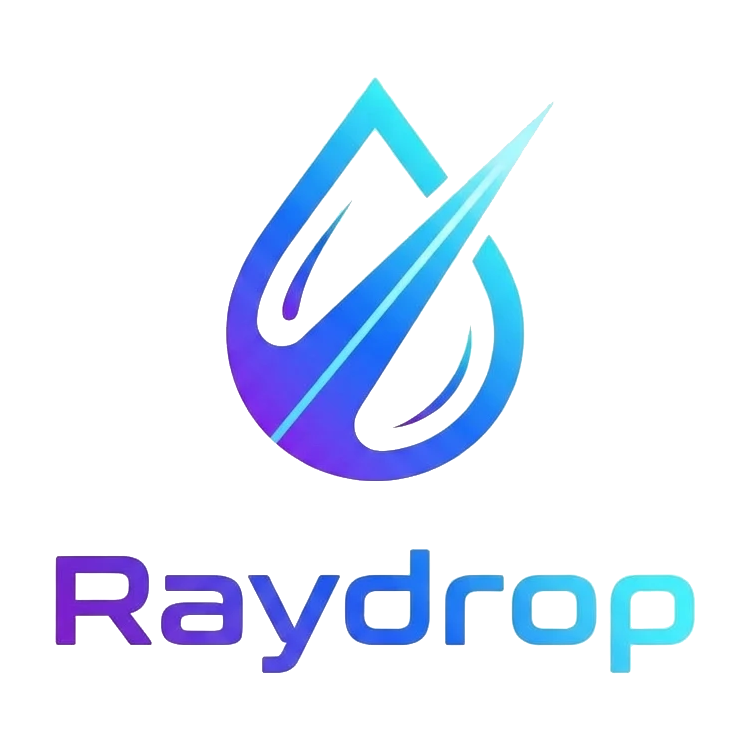

<p align="center">
  
</p>

<h1 align="center">Raydrop</h1>

<p align="center">
  <strong>Universal P2P File Transfer (LAN + Direct WAN)</strong><br />
  Fast, Resumable, End-to-End Encrypted File Sharing Across Devices with Zero Server Storage.
</p>

<p align="center">
  <a href="https://github.com/asepindrak/raydrop/releases/latest"></a>
  <a href="LICENSE"></a>
  <a href="https://tauri.app/"></a>
  <a href="https://www.rust-lang.org/"></a>
  <a href="https://svelte.dev/"></a>
  
  
</p>

---

## 🌟 Overview

**Raydrop** is an open-source, privacy-first peer-to-peer (P2P) file transfer application built with **Tauri v2 (Rust + Svelte 5 + Tailwind CSS)**. 

Unlike traditional file-sharing services that upload your files to third-party cloud servers, Raydrop establishes **direct, encrypted point-to-point connections** between sender and receiver devices across local Wi-Fi/LAN or over the public internet. 

**Your files and file metadata NEVER touch the cloud.**

---

## ✨ Key Features

### 🚀 High-Speed & Resumable Transfer Engine
- **Parallel Multi-Segment Streaming (IDM-Style):** Uses up to 6 concurrent parallel chunk streams for large files to maximize bandwidth utilization across local networks and WAN connections.
- **Resumable Transfers (`.raypart`):** If Wi-Fi disconnects or your PC sleeps, transfers seamlessly resume from where they stopped without re-downloading existing chunks from scratch.
- **Streaming BLAKE3 Integrity Checks:** Files are verified on-the-fly using cryptographic BLAKE3 hashes to guarantee bit-perfect delivery.
- **Zero-Latency Handshake:** Senders transmit the manifest instantly without pre-hashing bottlenecks.

### 🔒 Zero-Knowledge & Privacy-First Architecture
- **Zero File Storage on Servers:** The signaling server **never** stores, buffers, inspects, or logs your files, file names, file sizes, or transfer histories.
- **End-to-End Encryption (E2EE):** Every 512 KB chunk is encrypted with `ChaCha20-Poly1305` AEAD using ephemeral session keys negotiated via `X25519` Diffie-Hellman and `HKDF-SHA256` forward secrecy.
- **Cryptographic Device Identities:** Each device generates an `Ed25519` keypair with a tamper-proof Device ID format (`RAY-XXXX-XXXX-XXXX`).
- **Path Traversal Sanitization:** Incoming file paths are strictly sanitized to prevent directory traversal attacks (`../`).

### 🌐 Dual-Mode Connectivity
- **Local LAN Discovery (mDNS):** Automatically detects nearby devices on the same Wi-Fi/LAN via zero-config `_raydrop._tcp.local.`.
- **Direct Internet WAN P2P (STUN / Hole-Punching):** Establishes direct P2P connections across NATs using a lightweight self-hosted STUN reflector and WebSocket signaling server.

### 🖱️ Seamless Operating System Integration
- **Windows Explorer Context Menu:** Right-click any file, folder, or multi-selection and click **"Send with Raydrop"** to instantly queue transfers into the running System Tray background instance.
- **Auto-Focus Transfer Window:** Selecting files from the file manager automatically brings Raydrop to the foreground with an auto-focused contact selector for 1-click sending.
- **Foreground Alert for Incoming Files:** Automatically raises the modal prompt on the recipient's screen when a transfer request arrives.

### 📂 Rich Transfer Experience
- **Direct File Navigation:** Open downloaded files immediately or open the containing folder with the specific file automatically highlighted and focused in Windows Explorer.
- **Manifest Breakdown:** View full lists of received files, sizes, and folder trees.
- **Transfer History & Filter Tabs:** Easily switch between **All**, **Received**, and **Sent** records with timestamps, transfer speeds, and progress indicators.

---

## 🛡️ Security & Privacy Deep-Dive

Raydrop is engineered specifically for users and organizations who require absolute data sovereignty and cannot allow file transfers to be tracked or logged by intermediary servers.

### 🔍 Data Privacy Breakdown: What Is Stored Where?

| Data Type | Signal Server (VPS) | Client Local SQLite (`storage.db`) |
| :--- | :---: | :---: |
| **File Contents** | ❌ **Never (0 bytes stored/routed)** | ✅ Saved to user's chosen download directory |
| **File Names & Paths** | ❌ **Never tracked or stored** | ✅ Stored locally in recipient's private SQLite |
| **File Sizes & Hashes** | ❌ **Never logged or tracked** | ✅ Stored locally in device transfer history |
| **Transfer Logs & History** | ❌ **Zero server logs** | ✅ Kept 100% offline on the user's computer |
| **User Account & Password** | ✅ Securely hashed (Argon2id / Salted SHA-256) | ✅ Cached auth token for sign-in |
| **Registered Devices** | ✅ Device ID, name, OS, Ed25519 public key | ✅ Stored in local settings |
| **Contacts & Trust Level** | ✅ Approved contact relationships | ✅ Synchronized contact list |

> [!IMPORTANT]
> **No File Tracking Guarantee:** The central VPS server functions solely as a matchmaking and signaling switchboard. When Device A sends files to Device B, the file manifest and file streams travel **directly between the two devices**. The server never parses, reads, or records what files are being transferred.

### 🛡️ VPS Hardening & Anti-Brute-Force Safeguards
The Raydrop signaling server (`signal-server/`) is hardened against unauthorized access and denial-of-service:
- **Rate-Limiting & Auto-Lockout:** Failed authentication attempts trigger exponential delays. Exceeding 10 failed attempts within 5 minutes results in an automatic 10-minute temporary IP ban.
- **Timing Attack Mitigation:** Authentication tokens and password hashes are validated using constant-time byte comparisons (`constant_time_eq`).
- **Bounded Buffers & Memory Safety:** WebSockets enforce strict message size limits (2 MB frame cap) and bounded channel queues (256 messages) to prevent out-of-memory (OOM) exploits.
- **Identity Spoofing Protection:** All signaling messages (`CONNECT_INTENT`, `CANDIDATE_ANSWER`, etc.) are cryptographically validated against the sender's authenticated device session.

---

## 📥 Download

Pre-built binaries for **Windows (64-bit / x64)** are available on the [GitHub Releases](https://github.com/asepindrak/raydrop/releases):

| Package | Format | Description |
| :--- | :---: | :--- |
| **Windows Installer** | `.msi` | **Recommended:** Installs desktop shortcuts, start menu entry, and Windows Explorer context menu integration. |
| **Portable Executable** | `.exe` | Standalone portable binary that runs immediately without installation. |

👉 **[Download the Latest Release (v1.0.8)](https://github.com/asepindrak/raydrop/releases/latest)**

---

## 🛠️ Architecture & Wire Protocol

```
+-----------------------------------------------------------------------------------+
|                                  RAYDROP PROTOCOL                                 |
+-----------------------------------------------------------------------------------+
| 1. Discovery & Handshake                                                          |
|    - LAN: mDNS announcement (_raydrop._tcp.local.)                                |
|    - WAN: WebSocket Signaling (WSS) + UDP STUN Reflexive Address Discovery       |
|                                                                                   |
| 2. P2P Direct Channel (TCP / UDP Hole-Punch)                                      |
|    - Ephemeral X25519 Diffie-Hellman -> HKDF-SHA256 Session Key                  |
|    - Mutual Ed25519 identity verification                                         |
|                                                                                   |
| 3. Framed Encrypted Transport                                                     |
|    - Magic Header: "RAYD" (4 bytes)                                               |
|    - Payload Length (4 bytes)                                                     |
|    - Nonce: file_id (4 bytes) || chunk_offset (8 bytes)                          |
|    - AEAD Tag: Poly1305 (16 bytes)                                                |
|    - Ciphertext: ChaCha20 encrypted plaintext (512 KB per frame)                  |
|                                                                                   |
| 4. Integrity & Resume                                                             |
|    - Streaming BLAKE3 validation per completed file                               |
|    - Resumable partial file checkpoints (.raypart)                                |
+-----------------------------------------------------------------------------------+
```

---

## 🚀 Development & Self-Hosting

### 1. Self-Hosting the Signaling & STUN Server (`signal-server/`)

The signaling server is written in Rust using Axum and SQLite. You can deploy it easily using Docker Compose or Dokploy.

```bash
cd signal-server

# Copy example environment configuration
cp .env.example .env

# Run with Docker Compose
docker compose up -d --build
```

#### Firewall Requirements:
- **TCP Port `8080` (or `443` behind reverse proxy):** WebSocket Signaling & Auth API.
- **UDP Port `3478`:** STUN NAT Traversal / Public IP Reflector (must be directly accessible from the internet).

---

### 2. Building the Desktop Application

#### Prerequisites:
- **Node.js** (v18 or higher) & `npm`
- **Rust** toolchain (`rustup default stable`)
- **Visual Studio C++ Build Tools** (on Windows)

#### Run in Development Mode:
```bash
# Clone the repository
git clone https://github.com/asepindrak/raydrop.git
cd raydrop

# Install frontend dependencies
npm install

# Run desktop app with hot-reloading
npm run tauri dev
```

#### Build Production Binaries:
```bash
# Builds .msi installer and standalone .exe in src-tauri/target/release/
npm run tauri build
```

---

## 🤝 Contributing

Contributions, bug reports, and feature suggestions are always welcome!
1. Fork the repository.
2. Create your feature branch (`git checkout -b feature/amazing-feature`).
3. Commit your changes (`git commit -m "feat: add amazing feature"`).
4. Push to the branch (`git push origin feature/amazing-feature`).
5. Open a Pull Request.

---

## 📄 License

Raydrop is open-source software licensed under the [MIT License](LICENSE).
